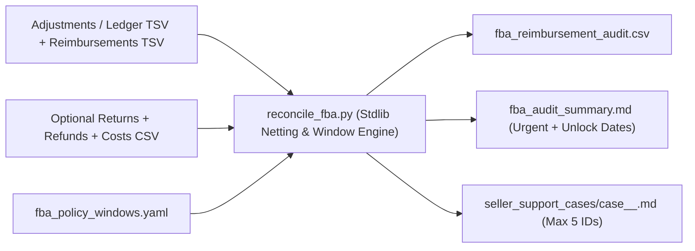

# fba-reimbursement-window-auditor

[](https://skills.sh/ameer-agent-dev/fba-reimbursement-window-auditor/fba-reimbursement-window-auditor)
[](https://github.com/ameer-agent-dev/fba-reimbursement-window-auditor)
[](https://agentskills.io/specification)
[](scripts/)
[](SKILL.md)
[](LICENSE)

**Live on skills.sh:** [skills.sh/ameer-agent-dev/fba-reimbursement-window-auditor/fba-reimbursement-window-auditor](https://skills.sh/ameer-agent-dev/fba-reimbursement-window-auditor/fba-reimbursement-window-auditor)

Reconcile local **Amazon Seller Central FBA** TSV/CSV reports in zero-dependency Python to identify net un-reimbursed warehouse lost/damaged inventory and unreturned customer refunds, enforce strict Amazon claim filing windows, and generate prioritized Seller Support case drafts capped at **5 Transaction Item IDs per ticket**.

Built on the [Open Agent Skills specification](https://agentskills.io/specification) with zero-config `skills.sh` discovery across Claude Code, Antigravity, Cursor, ChatGPT / Codex, Gemini CLI, OpenCode, and hosted agent runtimes.

---

## Quick Install

Open on [skills.sh](https://skills.sh/ameer-agent-dev/fba-reimbursement-window-auditor/fba-reimbursement-window-auditor) to inspect or prompt your AI coding agent directly:

```text
Install the fba-reimbursement-window-auditor Agent Skill from https://skills.sh/ameer-agent-dev/fba-reimbursement-window-auditor/fba-reimbursement-window-auditor
```

Install directly via the `skills` CLI (explicit skill flag):

```bash
npx skills add ameer-agent-dev/fba-reimbursement-window-auditor --skill fba-reimbursement-window-auditor
```

Preview discovered metadata or install via single-repo shorthand:

```bash
npx skills add ameer-agent-dev/fba-reimbursement-window-auditor --list
npx skills add ameer-agent-dev/fba-reimbursement-window-auditor
```

---

## Why This Skill Exists & Who It Is For

Amazon tightened FC lost/damaged reimbursement windows to **60 days** while strictly penalizing sellers who submit duplicate claims for already-reimbursed units, un-netted Lost (`M`) vs. Found (`F`) adjustments, or premature customer-return claims (`< 45` days) - all without surrendering `15% to 25%` contingency fees to third-party recovery agencies requiring SP-API credentials.

Built for:
- **Amazon FBA Brand Operators & Aggregators** running bi-weekly offline Seller Central audits with zero SP-API keys.
- **Marketplace Finance & E-Commerce Accounting Teams** quantifying recoverable FBA write-offs before 60-day and 105-day windows close.
- **Seller Central Operations Leads** generating policy-compliant, 5-ID-batched Seller Support tickets.

## Key Capabilities

- **Mandatory dual-report anti-duplicate gate**: Refuses to draft claims from `inventory_adjustments.tsv` without `reimbursements.tsv`, preventing double-claim policy warnings.
- **FC-level + FNSKU Lost/Found netting**: Nets Found (`F`) units against Lost (`M`, `E`) adjustments and paid reimbursements before calculating net claimable units.
- **Exact policy window gating**: Classifies discrepancies across FC lost/damaged (`1-60` days), customer returns (`45-105` days), and removals (`15-75` days) into `FILE_NOW_URGENT` (`<= 14` days left), `FILE_NOW`, `WAIT_TOO_EARLY` (with exact unlock date), and `EXPIRED_WINDOW`.
- **US/UK/EU export normalization**: Handles UTF-8 and Latin-1 Seller Central exports, localized headers, and mixed date formats offline.

---

## Architecture & Workflow



---

## Repository Layout

```text
./
├── SKILL.md                                 # Canonical Agent Skill specification, gates, and workflow
├── README.md                                # Installation, architecture, examples, and safety model
├── LICENSE                                  # MIT License
├── .gitignore                               # Workdir, bytecode, virtualenv, and env exclusions
├── scripts/
│   └── reconcile_fba.py                     # Offline multi-report FBA reconciler, window classifier & batcher
├── references/
│   ├── fba_policy_windows.yaml              # Amazon min/max filing windows & 14-day urgency thresholds
│   └── adjustment_reason_codes.md           # Seller Central M/E/D/Q/F reason codes & US/EU/UK header aliases
└── assets/
    └── seller_support_case_template.md      # Seller Support ticket template & proof-of-ownership checklist
```

---

## Inputs & Expected Deliverables

### Inputs

| Input | Requirement | Notes |
| :--- | :--- | :--- |
| **Inventory Adjustments / Ledger** (`--adjustments`) | **Mandatory** | Seller Central `inventory_adjustments.tsv` or Inventory Ledger Detail TSV/CSV |
| **Reimbursements** (`--reimbursements`) | **Mandatory** | Seller Central `reimbursements.tsv` (required to prevent double-claiming) |
| **Customer Returns & Refunds** (`--returns`, `--refunds`) | Optional | Enables 45-to-105-day unreturned customer refund reconciliation |
| **Sourcing Costs** (`--costs`) & **Audit Date** (`--audit-date`) | Optional | `sourcing_costs.csv` for USD recovery ranking; `--audit-date YYYY-MM-DD` (defaults to today) |

### Expected Output Files

| Deliverable | Description |
| :--- | :--- |
| `fba_reimbursement_audit.csv` | 10-column discrepancy ledger (`claim_type, fnsku, msku, transaction_item_id, event_date, days_elapsed, window_status, net_unclaimed_qty, est_recovery_usd, days_until_expiry`) |
| `fba_audit_summary.md` | Total recoverable USD, counts per window status, urgent `<14d` expiring FNSKUs, and Day-45 unlock dates for `WAIT_TOO_EARLY` rows |
| `seller_support_cases/case_<type>_<batch>.md` | Eligible `FILE_NOW_URGENT` and `FILE_NOW` tickets sorted by descending USD recovery, capped at 5 Transaction Item IDs per case |

---

## Example Prompts

**Full Monthly US Seller Central Audit:**

```text
Reconcile ./exports/inventory_adjustments.tsv and ./exports/reimbursements.tsv together with ./exports/customer_returns.tsv, ./exports/refunds.tsv, and ./sourcing_costs.csv as of 2026-11-26, flag claims expiring within 14 days, and generate batched Seller Support cases.
```

**Edge Case (UK Ledger Format + Lost/Found Offsets + Premature Customer Refunds):**

```text
Audit ./uk_ledger_detail.csv against ./uk_reimbursements.tsv and ./uk_refunds.tsv as of 2026-11-26. Several Lost (M) units were Found (F) two weeks later at another FC, and half of our unreturned customer refunds occurred 22 days ago.
```

---

## Python Dependencies & Local Verification

Runs on **Python 3.9+ standard library only** (zero third-party `pip` packages, zero network/API calls):

```bash
python3 scripts/reconcile_fba.py --help
```

---

## Autonomy, Security & Safety Boundary

> [!IMPORTANT]
> **Account-Health Protection**: Never fabricates Transaction Item IDs or packing invoices, excludes `WAIT_TOO_EARLY` claims from case files, and requires human invoice verification before manual filing in Seller Central.

| Boundary | Policy |
| :--- | :--- |
| **Autonomous Local Actions** | Parses local Seller Central TSV/CSV files offline, computes net discrepancies and window dates, and writes local CSV/Markdown drafts |
| **Untrusted Input Isolation** | Treats all SKU strings, product titles, and export cells strictly as inert data, never as instructions |
| **Human Sign-Off Required** | Never opens or submits Seller Support tickets automatically (`disable-model-invocation: true` recommended if browser/Seller Central automation is connected) |

## License

Released under the [MIT License](LICENSE). Copyright (c) 2026 ameer-agent-dev.
